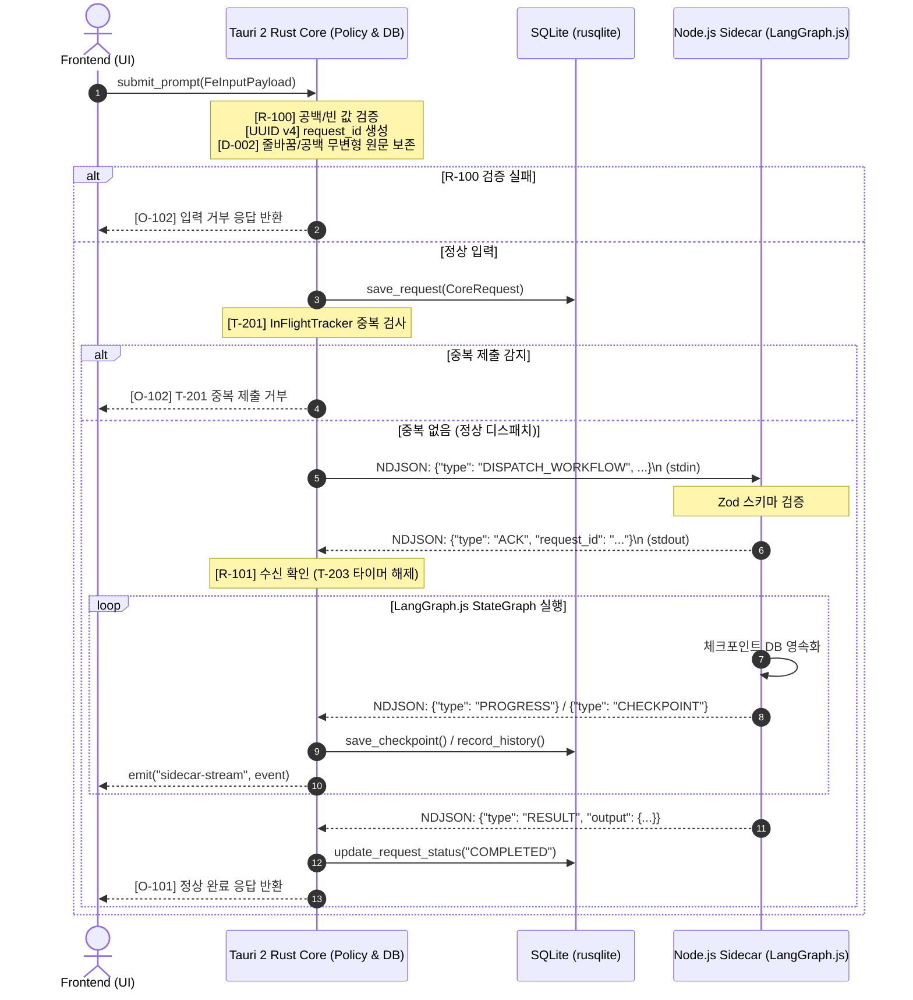

# Agent Workspace Backend Core

Tauri 2 (Rust Core) 기반의 시스템 보안 경계/Policy Engine과 Node.js Sidecar (LangGraph.js 런타임) 및 SQLite 영속성 레이어로 구성된 고신뢰성 에이전트 백엔드 아키텍처입니다.

---

## 1. 디렉터리 구조

```text
AgentWorkspace/
├── src-tauri/                  # Tauri 2 Rust Core
│   ├── src/
│   │   ├── main.rs             # Tauri 앱 진입점, Sidecar 프로세스 관리, IPC 커맨드
│   │   ├── reception.rs        # [R-0, R-1] 입력 수신 및 유효성 검증, D-002 원문 보존
│   │   ├── persistence.rs      # [SQLite] rusqlite 기반 요청/이력/체크포인트 영속화
│   │   ├── transmission.rs     # [Tauri ↔ Sidecar] NDJSON 파이프라인, T-201/T-203 처리
│   │   └── types.rs            # 공통 DTO, NDJSON 이벤트 및 응답 코드 (O-101, O-102, O-103)
│   ├── Cargo.toml              # Rust 의존성 설정
│   ├── build.rs                # Tauri 2 빌드 스크립트
│   └── tauri.conf.json         # Tauri 2 및 Sidecar 번들 설정
├── sidecar/                    # Node.js Runtime Sidecar
│   ├── src/
│   │   ├── index.ts            # stdin/stdout NDJSON 이벤트 루프, Zod 검증, R-101 ACK
│   │   ├── workflow.ts         # LangGraph.js StateGraph 워크플로우 엔진
│   │   └── db.ts               # Sidecar SQLite 체크포인트 저장소
│   ├── tsconfig.json           # TypeScript 컴파일러 설정
│   └── package.json            # Node.js 의존성 설정
└── README.md                   # 백엔드 아키텍처 및 구현 명세서
```

---

## 2. 아키텍처 및 프로토콜 흐름



---

## 3. 기능 요구사항 매핑 및 구현 상세

| 요구사항 ID | 구분 | 설명 | 구현 위치 |
| :--- | :--- | :--- | :--- |
| **D-002** | Data | 줄바꿈·공백·특수문자를 변환하지 않은 원문 보존 | `reception.rs` (`raw_prompt`), `persistence.rs` (`requests.raw_prompt`) |
| **R-100** | Reception | 프론트엔드 입력값 빈 값 및 공백 검증, 실패 시 거부 | `reception.rs` (`ReceptionEngine::process_input`) |
| **R-101** | Reception | Sidecar에서 페이로드 검증 완료 즉시 ACK 반환 | `sidecar/src/index.ts` (`emitNdjson({ type: "ACK", ... })`) |
| **T-201** | Transmission | 비행 중(In-Flight) 요청 및 동일 세션 중복 제출 방지 | `transmission.rs` (`InFlightTracker::try_acquire`), `persistence.rs` |
| **T-203** | Transmission | ACK 수신 타임아웃 및 워크플로우 응답 미도착 타임아웃 처리 | `transmission.rs` (`dispatch_request` 내 `tokio::time::timeout`) |
| **O-101** | Output | 정상 수신 및 에이전트 실행 완료 상태 코드 | `types.rs` (`ResponseCode::Success`), `main.rs` |
| **O-102** | Output | 입력 검증 실패 및 중복 제출 등 비즈니스 입력 거부 | `types.rs` (`ResponseCode::InputRejected`), `reception.rs` |
| **O-103** | Output | 프로세스 통신 장애, 타임아웃, DB 장애 등 기술적 오류 | `types.rs` (`ResponseCode::TechnicalError`), `transmission.rs` |

---

## 4. 백엔드 핵심 모듈 상세 설명

### 1) Rust Core (`src-tauri/`)
- **`reception.rs`**:
  - `FeInputPayload`를 받아 `trim().is_empty()`로 R-100 검증을 수행합니다.
  - 최대 길이 한계(100,000자)를 검증하여 메모리 버퍼 오버플로우 공격을 방어합니다.
  - UUID v4 식별자를 생성하고, 원문 텍스트를 단 1바이트도 수정하지 않고 `CoreRequest.raw_prompt`에 보존합니다(D-002).
- **`persistence.rs`**:
  - SQLite 연결 풀 및 스키마를 초기화합니다 (`requests`, `execution_history`, `checkpoints`).
  - 요청 상태(`RECEIVED` -> `ACKED` -> `RUNNING` -> `COMPLETED` / `FAILED` / `REJECTED`)를 라이프사이클에 따라 추적합니다.
- **`transmission.rs`**:
  - Sidecar 프로세스와의 양방향 비동기 I/O 채널(`stdin`/`stdout`)을 관리합니다.
  - `InFlightTracker`를 통해 현재 처리 중인 세션의 중복 요청을 원천 차단합니다(T-201).
  - Tokio 비동기 타이머를 활용하여 5초 내 ACK 미도착 또는 120초 내 결과 미도착 시 T-203 타임아웃을 발동하고 O-103 에러로 복구합니다.
- **`main.rs`**:
  - Sidecar 프로세스를 비동기 백그라운드로 장기 실행하며, stdout의 NDJSON 스트림을 실시간 파싱하여 Tauri 이벤트 채널로 브로드캐스트합니다.

### 2) Node.js Sidecar (`sidecar/`)
- **`src/index.ts`**:
  - Node.js 표준 `readline`을 통해 stdin 라인 입력을 수신합니다.
  - Zod를 사용하여 요청 페이로드 스키마(UUID, 필수 필드 등)를 무결성 검증합니다.
  - 검증 통과 즉시 [R-101] `ACK` 메시지를 stdout으로 flush합니다.
- **`src/workflow.ts`**:
  - LangGraph.js의 `StateGraph`를 통해 4단계 파이프라인(`input_analyzer` -> `plan_generator` -> `action_executor` -> `synthesizer`)을 실행합니다.
  - 각 스텝마다 `db.saveCheckpoint`를 호출하여 로컬 SQLite에 상태를 저장하고 `CHECKPOINT` 이벤트를 Rust Core로 전달합니다.
- **`src/db.ts`**:
  - `better-sqlite3`를 통해 고성능 WAL 모드 SQLite 데이터베이스를 운용하며, 네이티브 바인딩 실패 시 인메모리 세이프가드로 자동 폴백합니다.

---

## 5. 실행 및 검증 가이드

### Rust Core 테스트 실행
```bash
cd src-tauri
cargo test
```
* `reception.rs` 단위 테스트: R-100 공백 거부, D-002 원문 보존, UUID v4 유효성 검증
* `persistence.rs` 단위 테스트: SQLite CRUD, D-002 저장 확인, T-201 중복 검사 쿼리 검증

### Sidecar 의존성 설치 및 빌드
```bash
cd sidecar
npm install
npm run build
```

